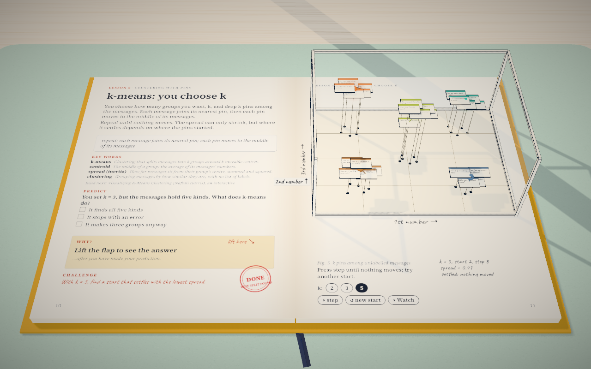

# Sorted

A 3D book that teaches you how to sort text messages into categories, starting from zero. It covers both ways to do it:

- **Classification**: you choose the categories and teach a model with labelled examples.
- **Clustering**: the model finds groups on its own, and you decide what they mean.

It has twelve lessons and needs no maths or machine-learning background.

**Read it here: https://mys1erious.github.io/sorted-book/**

It runs in the browser, with nothing to install and no sign-up. It needs WebGL, so use a recent Chrome, Edge, Firefox or Safari on a computer. It is not laid out for phones yet.

## How it works

Each lesson is a two-page spread of an open book lying on a desk:

- The left page explains one idea.
- The figure on the right page lifts off the paper as a 3D ink drawing you can play with.

The same two dozen short user messages appear in every lesson, such as "Why was I charged twice?", "Can you add a dark mode?" and "No, I meant the other button". They start as paper cards. They then become points in a glass case, where pins, bubbles and trays sort them.

## The lessons

| # | Lesson | What you do in the 3D figure |
|---|---|---|
| 1 | [Two ways to sort](https://mys1erious.github.io/sorted-book/#spread-2) | File cards into a cabinet's drawers yourself, or let them gather by similarity |
| 2 | [Text becomes numbers](https://mys1erious.github.io/sorted-book/#spread-3) | Turn messages into points in a glass case, and measure distances and nearest neighbours |
| 3 | [Teaching a classifier](https://mys1erious.github.io/sorted-book/#spread-4) | Watch the nearest labelled messages vote on a new one |
| 4 | [Testing a classifier](https://mys1erious.github.io/sorted-book/#spread-5) | Send a study pile and an exam pile into a confusion matrix of trays |
| 5 | [k-means: you choose k](https://mys1erious.github.io/sorted-book/#spread-6) | Step pins that claim their nearest cards and move until nothing changes |
| 6 | [Density clustering](https://mys1erious.github.io/sorted-book/#spread-7) | Grow reach bubbles: groups form where cards crowd, and the rest is noise |
| 7 | [How many clusters?](https://mys1erious.github.io/sorted-book/#spread-8) | Compare silhouette bars for k = 2 to 7 |
| 8 | [Squeezing dimensions](https://mys1erious.github.io/sorted-book/#spread-9) | Read the case's shadows on three walls, and see what a squeeze hides |
| 9 | [From group to label](https://mys1erious.github.io/sorted-book/#spread-10) | Name groups by their most distinctive words, and check that each name fits |
| 10 | [Is it any good?](https://mys1erious.github.io/sorted-book/#spread-11) | Play the intruder test: spot the card that does not belong |
| 11 | [Cluster, then classify](https://mys1erious.github.io/sorted-book/#spread-12) | Turn the groups you found into the drawers of lesson 1's cabinet |
| 12 | [Sorting new messages](https://mys1erious.github.io/sorted-book/#spread-13) | Sort a stream of new messages with a threshold, an "unknown" tray and a new drawer |

The back of the book has every source and an index of key words.

## How to read a lesson

1. **Watch.** The first time you open a lesson, a short camera tour plays. Press Esc to skip it, or the ▸ button to replay it.
2. **Predict.** Answer the question before you read on.
3. **Lift the flap** to see the answer and the reason for it.
4. **Try it.** Flip the switches, press the buttons and click cards in the 3D figure. The margin works out the numbers by hand as you go.
5. **Challenge.** Each lesson ends with a small task. The page gets a stamp when you complete it.

Use ← and → (or Page Up and Page Down) to turn pages. The toolbar has Contents, Watch and Still mode, which stops all motion. Still mode is on from the start if your system asks for reduced motion. Screen readers and keyboard users get a text version of every spread. Your answers and stamps are saved in your browser only.

## What is real and what is simplified

To be visible, each message is placed in the glass case by three numbers. Real models use hundreds: the one we used gives 384. So the positions in the book are placed by hand to reproduce what a real model did with these messages.

To check this, we ran a small open embedding model locally on the same messages: [all-MiniLM-L6-v2](https://huggingface.co/sentence-transformers/all-MiniLM-L6-v2). For one comparison we also ran [all-mpnet-base-v2](https://huggingface.co/sentence-transformers/all-mpnet-base-v2). The lessons quote these results:

| Lesson | What the real model did |
|---|---|
| 2 | In 3 of 6 hand-written pairs, a message that shared words with the anchor scored closer than one that shared its meaning (4 of 6 with mpnet) |
| 3 | Voting by nearest neighbours, with each message hidden in turn, got 8 of 25 right asking 1 neighbour, 11 asking 3, and 1 asking all |
| 4 | It scored 100% when tested on the cards it learned from, but only 11 of 20 on cards it had not seen |
| 5 | k-means with 5 groups matched the real kinds for 71% of messages |
| 7 | The silhouette score was highest at 8 groups. The 5 real kinds scored lower (0.028) than any k-means grouping |
| 8 | Squeezing 384 numbers down to 3 kept 25% of the variance, and only 8 of 27 messages kept their nearest neighbour |

Each lesson also says what it simplifies, and lists its sources.

## Credits

- The format follows [Every Joule](https://github.com/iamtechartist/every-joule-lesson1) by iamtechartist: a book whose figures lift off the page in 3D. This book's code was written separately.
- Built with [three.js](https://threejs.org/) and [Vite](https://vite.dev/).
- Set in [Source Serif 4](https://fonts.google.com/specimen/Source+Serif+4) and [Caveat](https://fonts.google.com/specimen/Caveat), both under the SIL Open Font License.

## About this repository

This repository holds only the built site. It lives on the `gh-pages` branch, which GitHub Pages serves. The source (lessons, 3D scenes and tests) is not published here.
